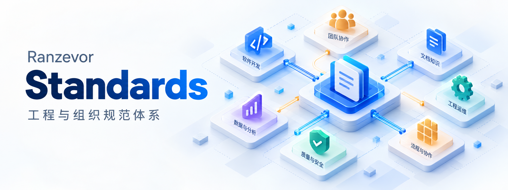

[](#status)
[](releases/v0.1.1.md)
[](LICENSE)
[](LICENSE)
[](guides/COMPATIBILITY.md)
[](guides/AUTHORING.md)
[](governance/VALIDATION.md)
[](guides/OFFLINE.md)

# Standards

[简体中文](README.md) · [Catalog — Chinese][catalog] · [Quick start](#quick-start) · [Language availability][languages]

<a id="purpose"></a>
## Project scope

Standards is an engineering and organizational standards system for Chinese-speaking developers, project initiators, researchers, maintainers and adopters. It connects applicability, implementation requirements, failure recovery and acceptance interfaces for human, agent and mixed teams across development, research, products, commercial fulfillment, open collaboration and production operations.

Project governance covers repositories and maintenance. L0–L3 organize architecture, governance, collaboration and general engineering; L4 supplies sixteen technical domains; L5 adapts technology stacks; L6 turns selected clauses into project adoption and implementation-acceptance contracts. Existing industry standards are referenced by exact version and bounded claims.

<a id="status"></a>
## Current version

**The distribution version is 0.1.1, with all 162 current normative documents adopted.** Exact document versions and digests are recorded individually in the registry. Use the [catalog][catalog] to find document identities and domains, the [adoption interface][adoption] to select applicable clauses, and the [project adoption template][adoptions] to record project choices. Formal release records are available through [GitHub Releases](https://github.com/ranzevor/Standards/releases).

<a id="quick-start"></a>
## How to use Standards

The tools require Python 3.12 and use only the standard library. Reading online requires no installation. The official release archive works after extraction and needs no account, credentials or environment variables.

### Start from the official release

1. Download [`Standards-v0.1.1-source.zip`](https://github.com/ranzevor/Standards/releases/download/v0.1.1/Standards-v0.1.1-source.zip) and [`SHA256SUMS.txt`](https://github.com/ranzevor/Standards/releases/download/v0.1.1/SHA256SUMS.txt) from [Standards v0.1.1](https://github.com/ranzevor/Standards/releases/tag/v0.1.1).
2. Verify the archive against its SHA-256 entry and extract it. The [offline guide](guides/OFFLINE.md#从公开发行入口首次使用) provides complete PowerShell and Ubuntu commands in Chinese.
3. In the extracted `Standards-v0.1.1/` directory, verify the bundle and run a minimal lookup from the source directory:

```sh
python -X utf8 -B verify.py
cd source
python -X utf8 -B tools/skill_lookup.py --document-id STD-PG-005 --clause-id PGE-05
```

Both commands should exit with code 0. The lookup result identifies `STD-PG-005`, `PGE-05`, the exact version, file path and source lines. If bundle verification fails, do not use that copy; download it again from the same Release and recheck the digest.

### Apply Standards to a project

1. **Find the task.** Choose a domain below or the [project governance framework][governance]; read its applicability and exclusions first.
2. **Fix the requirements.** Record document ID, exact version, content digest and clause IDs; use the [adoption interface][adoption] to identify project inputs, responsible actors, criteria and reasons for non-applicability.
3. **Implement and keep evidence.** Execute applicable requirements, recording passed, failed, unknown and not-run separately; document checks do not replace target-system acceptance.

When maintaining the repository, use Python 3.12 from the repository root, without optimization, to check the current documents, registries and tools:

```sh
python -X utf8 -B checks/validate_all.py
python -X utf8 -B -m unittest discover -s tests -v
```

The first command checks current directories, links, schemas and contract bindings; the second runs tests. See the [validation guide](governance/VALIDATION.md) for target types, optional environments and result interpretation.


<a id="navigation"></a>
## Find an entry by task

All twenty project governance standards have [full English translations](translations/en/project-governance/README.md). Other linked guides, policies and catalogs are currently **Chinese only**.

- **Understand the system:** [architecture][architecture] · [complete catalog][catalog]
- **Establish project governance:** [framework and responsibility interfaces][governance] · [README and branding — English full text][readme-standard] · [documentation and internationalization — English full text][documentation-standard] · [rights and licensing — English full text][rights-standard]
- **Adopt and adapt:** [getting started][getting-started] · [stack adapters][stacks] · [project adoption interface][adoption]
- **Author and change:** [authoring guide][authoring] · [templates][templates] · [compatibility and migration][compatibility]
- **Check the basis:** [official sources and limits][sources] · [language coverage and translation workflow][languages]

- **Software engineering (Chinese):** [Change workflow](guides/SOFTWARE-CHANGE-WORKFLOW.md) · [Quality gate design](guides/QUALITY-GATE-DESIGN.md) · [Artifacts, installation and recovery](guides/ARTIFACT-INSTALLATION-LIFECYCLE.md)
- **AI behavior profiles:** [Optional behavior guidance](guides/AI-BEHAVIOR.md) · [Scenarios and verification](examples/ai-agent/behavior/README.md)

- **Native platform validation:** [Encoding, paths and offline consumers](guides/CROSS-PLATFORM.md)

- **Adopt and maintain AI behavior profiles:** [Adoption, upgrades and feedback](guides/ai-behavior/ADOPTION.md) · [Feedback template](examples/ai-agent/behavior/FEEDBACK.template.md)

<a id="domains"></a>
## Sixteen technical domains

Select domains according to the project's actual components. All domain links below currently lead to **Chinese text**.

1. [Web front end and user interaction](standards/L4/web/README.md)
2. [Backend and distributed systems](standards/L4/backend/README.md)
3. [Databases and data engineering](standards/L4/database/README.md)
4. [Cloud infrastructure and DevOps](standards/L4/cloud/README.md)
5. [AI applications and agent systems](standards/L4/ai-agent/README.md)
6. [Model training and AI research](standards/L4/model-research/README.md)
7. [Desktop and cross-platform software](standards/L4/desktop/README.md)
8. [Mobile applications](standards/L4/mobile/README.md)
9. [Games and digital content](standards/L4/game/README.md)
10. [CLI, SDKs and developer tools](standards/L4/cli-sdk/README.md)
11. [Networking and real-time communication](standards/L4/network-realtime/README.md)
12. [Security engineering and identity](standards/L4/security/README.md)
13. [Automation and systems integration](standards/L4/automation/README.md)
14. [Embedded and edge computing](standards/L4/embedded-edge/README.md)
15. [Commerce, transactions and billing](standards/L4/commerce-billing/README.md)
16. [Open source and public technology ecosystems](standards/L4/open-source/README.md)

See [language availability][languages] for the project governance topics with full English translations.

## Technology and referenced practices

Tools use the Python 3.12 standard library. Normative text uses Markdown; registries and contracts use JSON and a finite JSON Schema validation profile. Source and Agent Skill distributions are available.

[](sources/common-governance.md)
[](sources/common-governance.md)

RFC and SSDF badges link to the [referenced practices and their stated scope](sources/common-governance.md). Chinese normative terms are defined by this project; only selected SSDF practices are referenced. [Badge documentation](guides/README-BADGES.md) describes evidence and maintenance (Chinese).

<a id="versions"></a>
## Versions and maintenance

[Change log][changelog] · [Offline distribution](guides/OFFLINE.md) · [Release policy][release] · [Maintenance and support][maintenance]

`standards/` is the sole entry for current normative text. `registry/` records document identities, clauses and relationships; `sources/` documents references; `guides/` and `templates/` provide practical guidance. Use document ID, version and content digest to select an exact object.

<a id="contributing"></a>
## Contribute improvements

Start with the [contribution guide][contribution] and raise problems, mechanisms or reproducible cases against concrete clauses. Contribution authorization and provenance follow actual terms; submitting material does not imply extra agreements. The [code of conduct][conduct] describes collaboration boundaries.

<a id="security"></a>
## Security issues

Follow the [security reporting guidance][security] for sensitive defects; do not paste secrets into ordinary public discussions. That page lists report fields, available channels and support scope.

<a id="license"></a>
## Rights and licensing

Standards uses a **split dual-license policy**: project-authored normative text, documentation, translations, templates, governance/normative data and visual assets are primarily licensed under **CC BY 4.0**; validators, tools, tests, automation, executable examples and software-oriented schemas are primarily licensed under **Apache-2.0**. Public redistribution of the repository and the official Source/Agent Skill consumption bundles is authorized under those applicable terms. Third-party material remains under its own terms. See the [license allocation](LICENSE), [license status][license] and [licensing policy][licensing].

[catalog]: INDEX.md
[languages]: guides/INTERNATIONALIZATION.md
[adoptions]: templates/project-governance/project-record.template.json
[governance]: translations/en/project-governance/framework.md
[architecture]: standards/L0/001-体系架构与规范编制准则--v0.1.0.md
[adoption]: standards/L6/001-项目采用与实现验收接口规范--v0.1.0.md
[getting-started]: guides/GETTING-STARTED.md
[stacks]: guides/STACK-ADAPTERS.md
[authoring]: guides/AUTHORING.md
[templates]: templates/README.md
[compatibility]: guides/COMPATIBILITY.md
[sources]: sources/README.md
[readme-standard]: translations/en/project-governance/readme-branding.md
[documentation-standard]: translations/en/project-governance/documentation-i18n.md
[rights-standard]: translations/en/project-governance/rights-license.md
[changelog]: CHANGELOG.md
[release]: governance/RELEASE.md
[maintenance]: governance/MAINTENANCE.md
[contribution]: CONTRIBUTING.md
[conduct]: CODE_OF_CONDUCT.md
[security]: SECURITY.md
[license]: LICENSE-NOTICE.md
[licensing]: governance/LICENSING.md
